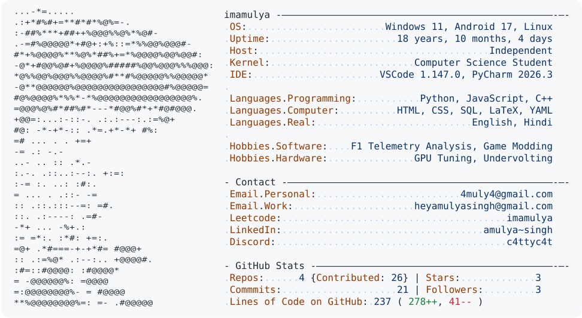

<a href="https://github.com/imamulya/imamulya">
  <picture>
    <source
      media="(prefers-color-scheme: dark)"
      srcset="https://raw.githubusercontent.com/imamulya/imamulya/main/dark_mode.svg">
    
  </picture>
</a>

  

